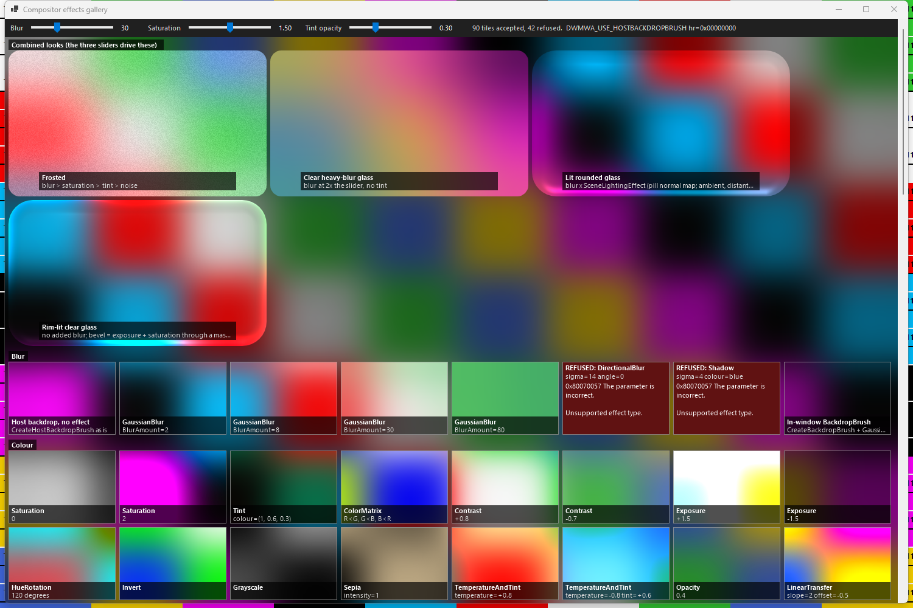

# Compositor effects gallery

> **A throwaway test, coded quickly in one sitting** (by Claude Code, at my request) to answer one question. It is not a library, not maintained and not tidy. Read it for the findings and for the interop it shows; don't build on it as it stands.

The question: what can an ordinary, unpackaged Windows desktop app do to the live picture of *whatever is behind its window*, using only the Windows compositor and no screen capture? In particular, can it bend that picture the way Apple's liquid glass does?

The app is one window with a grid of tiles. Each tile shows the compositor's host backdrop (`Compositor.CreateHostBackdropBrush`) run through one effect, with the effect's name and values printed on it. Effects the compositor refuses get a red tile with the error text.



## What it found (Windows 11 build 26300)

**No distortion is possible this way.**

- Every distorting effect is refused with "Unsupported effect type": DisplacementMap, Turbulence, 3DTransform, 3DPerspectiveTransform, Scale, Crop, Tile, Atlas, Straighten, Morphology, ConvolveMatrix.
- `Transform2D` straight on the backdrop is refused: "Backdrop brushes cannot be transformed".
- `Transform2D` over a `GaussianBlur` of the backdrop is accepted but does nothing. Scale, rotate, skew and mirror all leave the picture unchanged (measured on a bar-pattern test card).
- Rotating or scaling the visual moves only its shape. The backdrop inside stays aligned to the screen.
- A `CompositionVisualSurface` of a backdrop sprite renders black. `CompositionNineGridBrush` and `CompositionMaskBrush` refuse a backdrop brush.

**The backdrop arrives already blurred.** Through the "no effect" tile, 60 px colour bars can still be told apart but 2 px lines and text are gone. Effects can add blur, never remove it, so sharp clear glass is not available either.

**What does work:**

- GaussianBlur at any strength.
- Colour: Saturation, Tint, ColorMatrix, Contrast, Exposure, HueRotation, Invert, Grayscale, Sepia, TemperatureAndTint, Opacity, LinearTransfer, GammaTransfer, LuminanceToAlpha, ColorSource.
- Combining with app-drawn surfaces (tint, noise, masks): Blend (25 of 26 modes, including Hue, Saturation, Color and Luminosity, which Microsoft's page lists as unsupported), Composite (12 of 13 modes), ArithmeticComposite, CrossFade, AlphaMask, Border (only directly on a brush input).
- Lighting: the six Direct2D lighting effects, but only with no input, which gives flat pools and cones of light. `SceneLightingEffect` with composition lights and a normal map gives real rim highlights on a rounded shape.
- `Transform2D` on app-drawn surfaces.

**Also refused:** DirectionalBlur, Shadow, Posterize, Brightness, TableTransfer, DiscreteTransfer, Premultiply, UnPremultiply, HighlightsAndShadows, ChromaKey, RgbToHue, HueToRgb, WhiteLevelAdjustment, HdrToneMap, Emboss, EdgeDetection, Sharpen, Vignette, OpacityMetadata, Histogram, YCbCr, DpiCompensation, Blend mode Dissolve, Composite mode BoundedSourceCopy, and Direct2D lighting with any input ("Invalid effect input").

The full per-tile list with the compositor's error text is in [docs/results.txt](docs/results.txt), and the graph shapes that were probed are in [docs/probe.txt](docs/probe.txt).

## How it works

- .NET 10, WinForms, target framework `net10.0-windows10.0.22621.0`. No NuGet packages, no administrator rights, no screen capture.
- A dispatcher queue on the UI thread, `new Compositor()`, `ICompositorDesktopInterop.CreateDesktopWindowTarget` on the window handle, and the DWM attribute `DWMWA_USE_HOSTBACKDROPBRUSH`.
- Win2D is not used. `src/D2DEffect.cs` is one hand-written class that implements `IGraphicsEffect` and answers `IGraphicsEffectD2D1Interop` through `ICustomQueryInterface`. `src/Fx.cs` has one constructor per Direct2D effect, with ids and property order taken from `d2d1effects.h`.
- App-made bitmaps (noise, masks, normal maps, the caption layer) go into composition surfaces through a Direct3D 11 device (`src/Surfaces.cs`).
- The composition visuals draw on top of everything the window itself paints and under its child windows. That is why the captions are a composition surface and the sliders are child controls.

## Run it

```
dotnet run -c Release
```

The three sliders drive the large "looks" at the top. `--probe <file>` runs the graph-shape probes with no window and writes the answers to the file.

`TestCard` is the harness that was used to check the gallery without looking at the desktop: it shows an opaque striped card, puts the gallery on top of it, and saves a picture of the card's rectangle only (`TestCard/run-test.ps1`).

## Not checked

- The gallery with keyboard focus. Every test picture was taken with it unfocused.
- Dragging the sliders, scrolling and resizing by hand.
- Display scaling above 100%, Windows 10, and hosting the same thing inside WPF.
